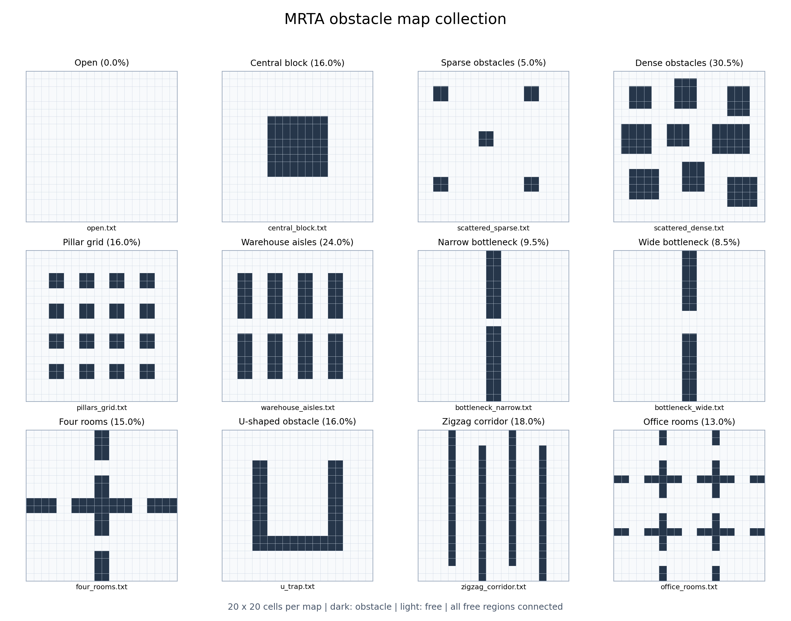
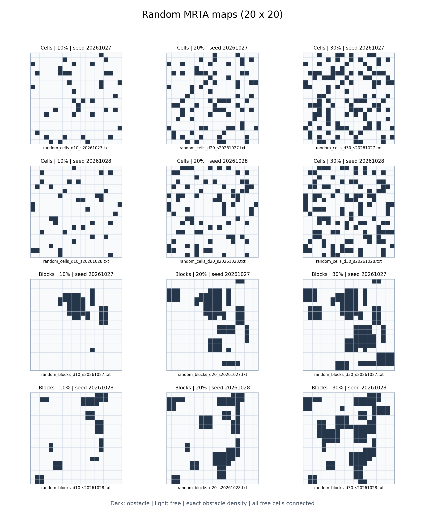

# 障碍地图集合

本目录提供 **12 张典型地图和 12 张随机地图**，统一为 **20×20**，`#` 为障碍，`.` 为自由区域。所有自由格都通过上下左右相邻关系连通，不需要穿过障碍角点，适合当前要求场景内导航点两两可达的路径预计算。原有 `example.txt` 为 10×10。

## 典型地图



| 地图 | 布局 | 障碍占比 | 适合观察 |
|---|---|---:|---|
| [open.txt](open.txt) | 无障碍空场 | 0% | 欧氏距离基线、直线路径 |
| [central_block.txt](central_block.txt) | 中央大方块 | 16% | 左右两侧绕行、连续坐标折线路径 |
| [scattered_sparse.txt](scattered_sparse.txt) | 稀疏分布的小方块 | 5% | 少量局部绕行、多数点对可直达 |
| [scattered_dense.txt](scattered_dense.txt) | 密集分布的不同大小矩形 | 30.5% | 多次绕行、不规则通道 |
| [pillars_grid.txt](pillars_grid.txt) | 规则柱阵 | 16% | 多条可选路径、重复结构 |
| [warehouse_aisles.txt](warehouse_aisles.txt) | 两排纵向货架及中间横向通道 | 24% | 货架间移动、横向通道选择 |
| [bottleneck_narrow.txt](bottleneck_narrow.txt) | 中间隔墙，单格宽开口 | 9.5% | 窄通道、跨区域绕行 |
| [bottleneck_wide.txt](bottleneck_wide.txt) | 同一隔墙，三格宽开口 | 8.5% | 与窄开口图比较通道宽度的影响 |
| [four_rooms.txt](four_rooms.txt) | 四房间，房间之间通过门洞连接 | 15% | 分区任务、跨房间移动 |
| [u_trap.txt](u_trap.txt) | 开口朝上的 U 形障碍 | 16% | 凹形障碍、先远离目标再绕行 |
| [zigzag_corridor.txt](zigzag_corridor.txt) | 顶部和底部交替留口的四道隔墙 | 18% | 长距离蛇形绕行、欧氏距离低估 |
| [office_rooms.txt](office_rooms.txt) | 3×3 房间网格，隔墙设门洞 | 13% | 多房间路径、多次过门 |

默认物理地图边长为 100，因此每个字符格边长为 5：窄开口宽度为 5，宽开口为 15。当前规划器将机器人视为点；上述宽度描述地图几何。

## 随机地图



两种随机风格，每种包含 10%、20%、30% 三种障碍占比，每组两个随机种子，共 12 张。每张地图的障碍格数分别严格为 40、80、120。生成时逐次尝试添加障碍，拒绝会分割自由区域的添加，因此自由格保持四邻域连通；这些地图是带连通性约束的随机样本。

- `cells`：随机添加单个障碍格，可能形成相邻障碍簇。
- `blocks`：随机添加边长为 1–4 格的矩形，允许相接或重叠，形成大小不同的障碍块。

| 风格 | 障碍占比 | 种子 20261027 | 种子 20261028 |
|---|---:|---|---|
| 随机散点 | 10% | [cells_d10_01](random_cells_d10_s20261027.txt) | [cells_d10_02](random_cells_d10_s20261028.txt) |
| 随机散点 | 20% | [cells_d20_01](random_cells_d20_s20261027.txt) | [cells_d20_02](random_cells_d20_s20261028.txt) |
| 随机散点 | 30% | [cells_d30_01](random_cells_d30_s20261027.txt) | [cells_d30_02](random_cells_d30_s20261028.txt) |
| 随机矩形 | 10% | [blocks_d10_01](random_blocks_d10_s20261027.txt) | [blocks_d10_02](random_blocks_d10_s20261028.txt) |
| 随机矩形 | 20% | [blocks_d20_01](random_blocks_d20_s20261027.txt) | [blocks_d20_02](random_blocks_d20_s20261028.txt) |
| 随机矩形 | 30% | [blocks_d30_01](random_blocks_d30_s20261027.txt) | [blocks_d30_02](random_blocks_d30_s20261028.txt) |

完整的种子、尺寸、障碍格数与生成规则见 [random_maps_seed20261027.json](random_maps_seed20261027.json)。随机地图在默认物理参数下同样是 100×100，每格 5×5，小车速度为 1 长度单位/秒。

后续生成更多地图可使用 [generate_random_maps.py](../generate_random_maps.py)，例如换一组种子，在同一目录下再生成 12 张：

```bash
python z_test_path/generate_random_maps.py \
  --size 20 --densities 10 20 30 \
  --styles cells blocks --count 2 --seed 20261101 \
  --output_dir z_test_path/maps
```

每组使用的实际种子为 `--seed + 序号`，序号从 0 开始。文件名包含风格、障碍占比和实际种子。默认拒绝覆盖已有文件；复现本批地图可使用 `--seed 20261027` 并指定新的输出目录。生成器只写地图和 JSON 清单，不生成 MRTA 数据或规划缓存。

## 使用地图生成数据

在项目根目录、`mrta_c` 环境中执行，例如生成窄通道场景：

```bash
python z_test_path/generate_test_set.py \
  --map_file z_test_path/maps/bottleneck_narrow.txt \
  --graph_size 100 \
  --n_agents 5 \
  --dataset_size 100 \
  --seed 20261027 \
  --filename z_test_path/data/n100_bottleneck_narrow_r5.pkl
```

更换 `--map_file` 与输出文件名即可使用其他地图。地图会写入生成的 `.pkl`，更换或编辑 `.txt` 后需要重新生成数据，已有数据集不受影响。生成的数据可交给 `z_test_path/evaluate.py` 或 `EILS/evaluate.py`，使用 `--path_planner visibility_dijkstra` 评估。

比较地图时，保持任务数、机器人数量、截止时间分布、工作量、速度和搜索预算一致。示例固定为 5 个机器人，以免各数据集的机器人数量占比影响整体 cost。相同随机种子下，任务和机器人坐标仍会随地图自由区域重新采样；这属于不同布局的比较，不是固定同一组坐标的有无障碍对照。

## 已做检查

本目录的 24 张 20×20 地图通过格式与四邻域连通性检查；每张图还选取 5 对自由格中心，用可见图 + Dijkstra 和栅格 A*（`subdivisions=2`）分别检查可达性、路径端点及每段路径无碰撞。

12 张随机地图另检查了实际障碍占比，并在临时目录中重新运行生成器，确认相同参数下地图文件逐字节一致、清单一致，重复生成会拒绝覆盖。
